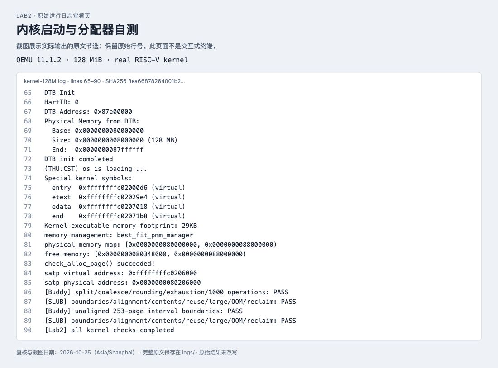
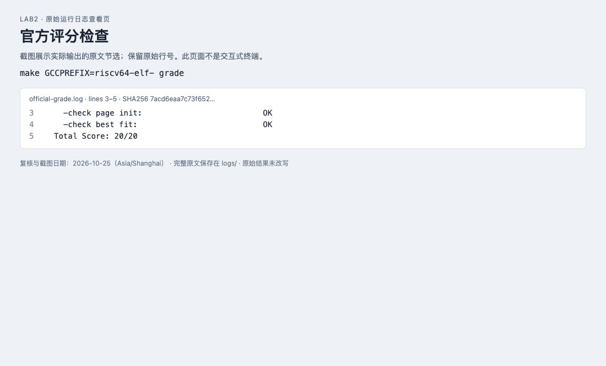
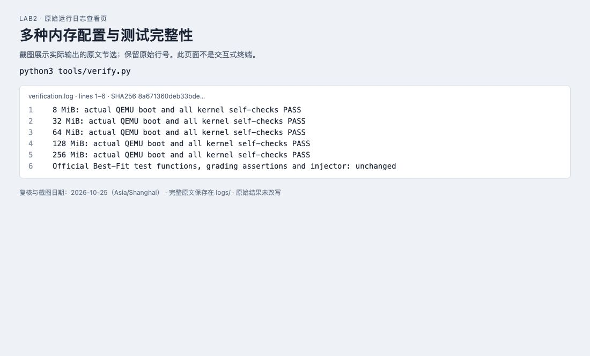
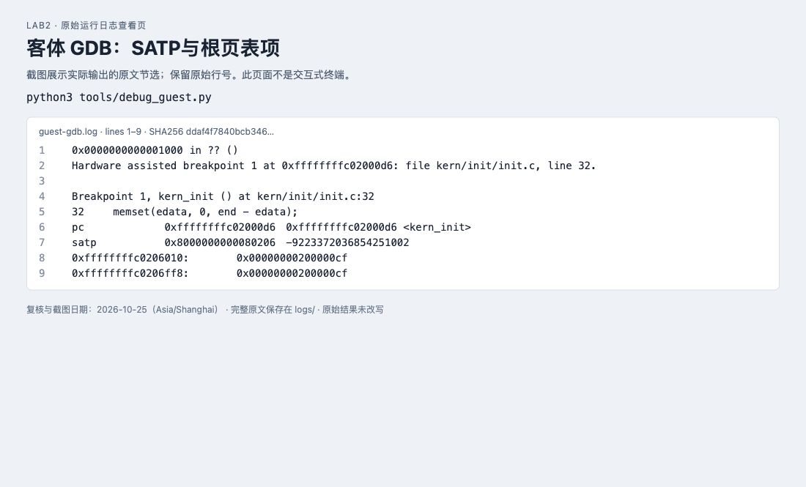
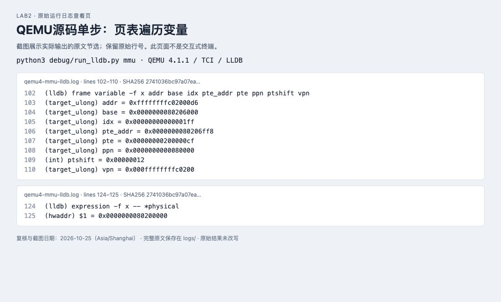
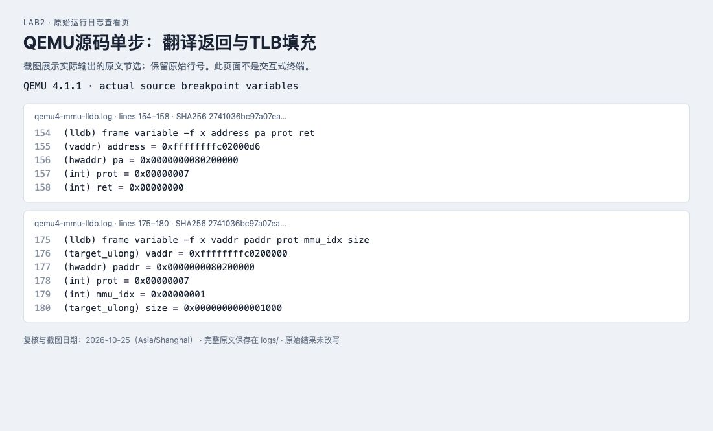
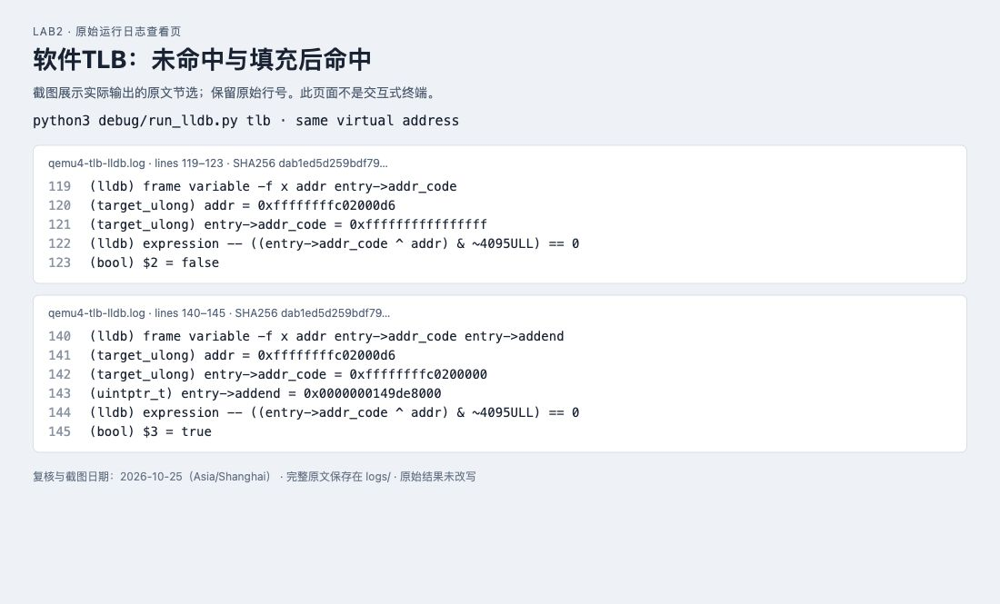
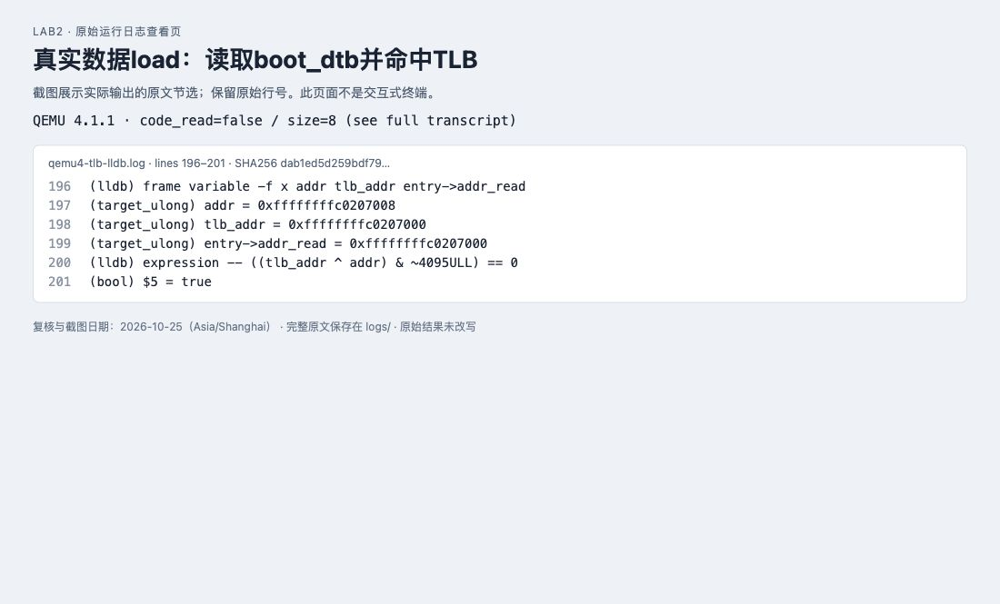

# 操作系统实验二：物理内存管理与页表

小组成员：刘琦（2311764）、李金璇（2312418）、赵非凡（2411020）

实验日期：2026年10月24日　复核与截图日期：2026年10月25日

## 一、实验目的与环境

本实验围绕物理内存探测、页描述符初始化、连续物理页分配及页表地址翻译展开。目标是理解内核如何从设备树获得内存范围，如何排除固件和内核占用，如何用统一物理内存管理接口实现Best-Fit与Buddy，以及如何在页分配之上实现小对象分配。最后通过客体GDB和QEMU源码调试观察SATP、页表遍历与软件TLB。

| 项目 | 实际环境 |
|---|---|
| 宿主系统 | macOS / arm64 |
| 内核架构 | RISC-V 64位，Sv39 |
| 交叉编译器 | riscv64-elf-gcc 16.2.0 |
| 日常启动与评分 | QEMU 11.1.2，默认OpenSBI v1.8.1 |
| 源码调试 | QEMU 4.1.1，TCI解释器后端，OpenSBI v0.4 |
| 客体调试器 | riscv64-elf-gdb 18.1 |
| 宿主源码调试器 | Apple LLDB |
| 实验源码 | 课程lab2.zip，原包目录lab2_new |

本报告的截图是本次重新运行后，对本地“原始运行日志查看页”的浏览器截图。页面只展示原文节选、原始行号和日志SHA256摘要，不是交互式终端截图。完整日志随附件提交，可以核对截图内容。QEMU4.1.1的解释器后端及宿主LLDB属于本机适配，不能描述成完全相同的Linux双GDB环境。

## 二、实验整体逻辑

内核入口保存 OpenSBI 传入的 hartid 和设备树地址，设置 Sv39 根页表、开启分页并跳转到高虚拟地址的 C 入口。`dtb_init()` 解析内存基址和大小。随后 `pmm_init()` 先选择管理器并初始化其空闲结构，再由 `page_init()` 布置 Page 数组、保留固件与内核占用，将剩余完整页交给 `init_memmap()`。此后分配回收通过统一 `alloc_pages()/free_pages()` 接口完成，管理器的 `check()` 验证算法。对象分配层再在页分配器之上提供 `kmalloc()/kfree()`。

物理内存管理器决定哪些页可用；页表决定一个虚拟地址如何翻译到物理地址。两者有关联但不是同一个功能。本实验的启动映射已由汇编静态建立，Best-Fit本身不建立每次分配对应的新页表。

实现链为：

```text
kern_entry -> kern_init -> dtb_init -> pmm_init
  -> init_pmm_manager -> page_init -> init_memmap
  -> alloc_pages/free_pages -> check_alloc_page
  -> Buddy隔离区域测试 -> SLUB对象层测试
```

## 三、核心功能实现与分析

### page_init

`va_pa_offset` 为 `PHYSICAL_MEMORY_OFFSET`。DTB 基址必须符合框架固定的 `DRAM_BASE`，大小非零且加法不溢出；上界裁剪到 `PHYSICAL_MEMORY_END` 并向下页对齐。`npage` 是物理上界的绝对页号，而非可分配页总数。描述符数量为 `npage-nbase`。

`pages` 从链接符号 `end` 向上按4KiB对齐后开始。写入描述符前，验证内核与整个数组确实放得下。所有描述符先标为 reserved，数组结束地址再次向上页对齐，只有其后的完整页才交给管理器。空区不调用 `init_memmap()`。描述符地址是内核虚拟地址，`page2pa` 返回物理地址，`pa2page` 返回描述符指针，不能混用。

本实现接受一段连续RAM，保留从DRAM起点到描述符末尾的整个前缀。它不是支持多个不连续RAM区域、设备树所有 reserved-memory 节点或NUMA的通用实现。

### First-Fit理解与改进

`default_init` 建立空链表和零计数。`default_init_memmap` 将已保留的页改为可用页，把块长写到首个Page的property，并按地址插入链表。`default_alloc_pages` 从低地址起查找第一个足够的块，从块首切走请求大小，余块重新挂链。`default_free_pages` 插回后分别检查前后块是否物理相邻，相邻则合并。

改进方向包括按大小组织索引以降低搜索开销、next-fit减少重复前缀扫描、伙伴系统加快特定大小块拆合，以及按工作负载选择策略。First-Fit简单但容易在低地址区域积累小碎片。不能无条件声称Best-Fit必然更好；Best-Fit也可能制造大量难以使用的小余块。

### Best-Fit

复用First-Fit的地址有序链表和回收合并过程，分配时遍历所有块，选择满足请求的最小块；大小相同时保持先遇到的低地址块。切分余块和总页数更新保持与官方测试兼容。注册完整 `best_fit_pmm_manager`，默认选择它。搜索复杂度O(空闲块数)，额外管理结构为O(1)；可以用按大小排序树或分桶优化，但会增加合并与索引一致性的维护成本。

官方 `basic_check` 和 `best_fit_check` 未修改。`tools/verify.py` 对测试区原始字节进行比较，避免“改测试让测试通过”。

### Buddy

每阶一条链表，块大小为2的幂，按物理页号对齐。初始化允许将不满足整块对齐的范围拆成多个合法块。请求向上取整到某阶，从该阶或更高阶取块，递归拆分。释放按原始请求数求相同阶，`ppn XOR (1 << order)` 求伙伴，仅合并同阶空闲伙伴。

接口契约：申请3页实际占用4页，释放时传回原始请求3；不能对Buddy分配块任意切片释放。本实现为单核教学版，没有并发锁、NUMA分区或Linux迁移类型。使用首描述符的ref=-1标记已分配头，辅助拒绝非法或重复释放；这与框架暂未使用引用计数的Lab2环境绑定，后续实验若使用ref需调整元数据设计。

为避免污染Best-Fit的状态，启动检查先借511页，在其中选出256页对齐区，仅在该区域切换 `pmm_manager` 为Buddy，完成测试后清理描述符并恢复Best-Fit，再归还借用区。

测试覆盖：3页请求扣4页、对齐、不重叠、耗尽、NULL、逆序释放、最大块重新分配、零/超阶请求、1000次混合分配释放及最终计数恢复。测试对随机阶段允许合法OOM；空闲计数与不重叠、最大块恢复联合验证，避免仅凭总页数掩盖碎片或重叠错误。

### 简化SLUB

页层通过当前pmm管理器申请；对象层使用32、64、128、256、512、1024、2048字节大小类。每个slab页包含头部、空闲对象链表和占用位图。分配取一个槽，回收更新位图，整个slab空闲时立即归还页。超过2048字节走连续多页分配，头部记录真实页数。

0字节、整数溢出和OOM返回NULL；`kfree(NULL)`为无操作；对象按16字节对齐。只允许释放本分配器返回、尚未释放的对象首指针。大对象必须传回首指针，不能释放内部地址。非法任意指针、释放后使用等仍属于调用方错误；它不是带隔离防护的通用堆。

这是体现两层架构的SLUB风格简化实现，不包含Linux SLUB的per-CPU缓存、完整partial/full队列、并发与调试体系。测试覆盖大小类边界、跨页大对象、200个对象跨slab并存、交错释放和复用、逐字节内容检查、对齐、OOM和全部归还；分别在Buddy和Best-Fit后端执行。

### 物理内存初始化中的关键代码

下面摘录当前实现的边界计算和空闲区注册代码；完整函数位于源码 `kern/mm/pmm.c`。

```c
    uintptr_t limit = base + size;
    if (limit > PHYSICAL_MEMORY_END) limit = PHYSICAL_MEMORY_END;
    limit = ROUNDDOWN(limit, PGSIZE);
    uintptr_t desc_pa = PADDR(ROUNDUP((uintptr_t)end, PGSIZE));
    if (limit <= desc_pa) panic("RAM cannot hold kernel and descriptors");
    npage = PPN(limit);
    size_t count = npage - nbase;
    if (count > (limit - desc_pa) / sizeof(struct Page))
        panic("RAM cannot hold page descriptors");
    pages = (struct Page *)(desc_pa + va_pa_offset);
    for (size_t i = 0; i < count; i++) {
        pages[i].flags = 0;
        pages[i].property = 0;
        set_page_ref(pages + i, 0);
        SetPageReserved(pages + i);
    }
    uintptr_t free_pa = ROUNDUP(desc_pa + count * sizeof(struct Page), PGSIZE);
    cprintf("physical memory map: [0x%016lx, 0x%016lx)\n", base, limit);
    cprintf("free memory: [0x%016lx, 0x%016lx)\n", free_pa, limit);
    if (free_pa < limit) init_memmap(pa2page(free_pa), (limit - free_pa) / PGSIZE);
```

此处先检查描述符所需空间，再写入Page数组；否则即使最终空闲页数看起来正确，也可能在初始化过程中先覆盖有效内存。`free_pa < limit` 保证只有存在完整空闲页时才调用 `init_memmap()`。

## 四、关键操作步骤、截图与结果解释

### 步骤1：编译并运行完整内核

```sh
make GCCPREFIX=riscv64-elf- -j4
make GCCPREFIX=riscv64-elf- qemu
```

设备树报告内存范围为0x80000000到0x88000000（右端不含），共128 MiB。内核实际选择Best-Fit管理器。初始化后完整自检输出包含Best-Fit、Buddy、两种后端上的SLUB测试，以及未对齐253页区域的边界检查。




图1　内核启动与分配器自测。`check_alloc_page()`及各项自测均输出成功，最后出现完整结束标记。两条SLUB成功行分别对应Buddy后端和Best-Fit后端；它们不是两项官方评分。


### 步骤2：运行官方评分检查

```sh
make GCCPREFIX=riscv64-elf- grade
```

评分脚本在临时副本注入课程测试，保留原始测试断言。两项检查分别对应Page初始化和Best-Fit管理器，结果为20/20。这个分数不包含Buddy、SLUB或教师现场问答。




图2　官方评分结果。Page初始化与Best-Fit均为OK，总分20/20。


### 步骤3：验证不同内存配置与测试完整性

```sh
python3 tools/verify.py
```

脚本实际启动8、32、64、128、256 MiB配置，检查完整成功标记且无kernel panic，同时逐字节比对原包中Best-Fit测试函数、官方测试文件及注入器，确认未通过改动测试获得通过。




图3　多内存配置验证。五种配置均通过。256 MiB配置仍按框架上限只管理前128 MiB；该结果不能解释为支持256 MiB全范围分配。


### 步骤4：用客体GDB读取SATP与根表项

```sh
python3 tools/debug_guest.py
```

脚本让QEMU暂停启动，以RISC-V GDB连接，在 `kern_init` 设置硬件断点。命中后读取PC、SATP及根页表2号和511号项。




图4　客体GDB断点与页表读数。SATP为0x8000000000080206，根表两项均为0x200000cf；其中2号项服务于开启分页后的过渡取指，511号项服务于高虚拟地址。


### 步骤5：在QEMU源码中单步页表翻译

```sh
python3 debug/run_lldb.py mmu
```

该命令从附件根目录执行。通过地址条件断点停在QEMU4.1.1的 `get_physical_address`，观察页表索引、PTE地址、PTE内容和翻译结果。




图5　页表遍历中的实际变量。虚拟地址0xffffffffc02000d6对应根表索引511，读取0x80206ff8中的PTE=0x200000cf。单步计算出的物理页基址为0x80200000。




图6　翻译成功与软件TLB填充。ret=0表示翻译成功。写入软件TLB的页映射为0xffffffffc0200000到0x80200000，权限prot=7，缓存粒度参数为0x1000。


### 步骤6：对比TLB未命中、命中与数据读取

```sh
python3 debug/run_lldb.py tlb
```

条件断点首先观察相同VA的首次查询，再观察填充后的标签。进一步在 `load_helper` 中选择 `code_read=false` 的8字节读取，验证真实数据访问也使用软件TLB。




图7　同一虚拟地址的TLB未命中与命中。首次标签全1，按页比较为false；填充后标签变为0xffffffffc0200000，同一地址比较为true。




图8　boot_dtb数据读取的TLB命中。实际数据VA为0xffffffffc0207008，addr_read标签为0xffffffffc0207000，比较为true。完整日志保留了code_read=false、size=8及调用栈。


## 五、页表与TLB调试分析

在macOS arm64上实际构建了带符号的QEMU 4.1.1。原生TCG缓冲区分配失败后，使用QEMU自带TCI解释器后端，且仅对解释器缓冲区去掉PROT_EXEC，未改变页表遍历或TLB逻辑。使用其自带OpenSBI v0.4，整个内核自检也正常结束。宿主源码调试使用LLDB，客体调试使用RISC-V GDB；采用指导书允许的“宿主条件断点”替代流程。具体构建方式见 `debug/BUILD.md`，源码缓冲区改动见 `debug/tci-buffer.patch`。

### 地址翻译与关键分支

实际调用路径为：

```
cpu_exec -> tb_find -> tb_lookup__cpu_state -> tb_htable_lookup
 -> get_page_addr_code -> tlb_fill -> riscv_cpu_tlb_fill
 -> get_physical_address -> tlb_set_page -> tlb_set_page_with_attrs
```

`get_physical_address`：先检查M态和MMU是否启用，再读取SATP MODE。Bare模式直接返回物理地址；Sv39设置levels=3、索引宽度9、PTE大小8。检查虚拟地址高位符号扩展后逐层取索引，计算PTE物理地址并读取，判断V、RWX、用户/监管权限、超页PPN对齐及A/D位。如果RWX全零才将其当作下一层指针；遇到合法叶子就停止，不一定遍历三层。

实际断点读数（`report/logs/qemu4-mmu-lldb.log`）：

| 变量 | 实测值 |
|---|---|
| addr | 0xffffffffc02000d6 |
| env->satp | 0x8000000000080206 |
| base | 0x80206000 |
| idx | 0x1ff |
| pte_addr | 0x80206ff8 |
| pte | 0x200000cf |
| ppn | 0x80000 |
| ptshift | 0x12，即18 |
| 翻译函数输出的物理页基址 | 0x80200000 |
| TLB写入的虚拟页基址 | 0xffffffffc0200000 |
| TLB写入的物理页基址 | 0x80200000 |
| TLB填充size参数 | 0x1000 |

对 `*physical = ...` 语句实际单步后，得到0x80200000；加原访问页内偏移0xd6，最终访存物理地址为0x802000d6。这里1GiB硬件叶子映射在QEMU该填充路径中以4KiB软件TLB条目缓存，不能把TLB size参数误认为原PTE也是4KiB叶子。

### TLB查找、未命中与填充后的命中

QEMU4.1.1的 `accel/tcg/cputlb.c` 中，`get_page_addr_code` 查询addr_code标签；`load_helper` 根据取指/数据读取选择addr_code/addr_read。未命中先检查victim TLB，再调用架构相关tlb_fill；命中后可通过entry的addend等信息访问主机RAM。

实际条件断点日志（`report/logs/qemu4-tlb-lldb.log`）记录同一VA：

1. 首次 `get_page_addr_code` 查询时 `entry->addr_code=0xffffffffffffffff`，按页比较为false，进入未命中分支。
2. 填充后 `entry->addr_code=0xffffffffc0200000`，比较为true。
3. 随后的 `load_helper` 取指读取仍命中同一标签，比较为true，记录了实际调用栈。

另在SATP为0时命中地址翻译函数并观察直接映射路径。这说明QEMU软件TLB不仅用于模拟客体页表缓存，也用于加速客体物理地址到宿主内存访问；Bare模式与M态并不意味着模拟器内部完全不需要缓存。真实CPU TLB的具体组织、相联度、替换策略及时间开销不能从这段QEMU实现直接推断。

### 调试过程中的认识

最容易误判的是把“三级Sv39”理解成每次必走三层。本内核的根页表项本身就是1GiB叶子，源代码断点显示第一层就得到最终映射。另一个细节是宿主变量名physical保存的是对齐后的页基址，而不是包含页内偏移的最终地址；忽略这一点就会把0x80200000与0x802000d6误判成翻译错误。

LLDB从函数step-out停止时，调用方返回值赋值指令可能尚未执行；必须再step-over，才能读取更新后的ret。最初日志中看到的旧ret值不能解释成翻译失败，最终复现脚本已增加该步。

## 六、Spec与提示词设计

本次代码由当前Codex会话直接完成。下列内容将实现约束整理为可复用的规格与提示词，不冒充另外发生过的独立模型聊天。实现与测试分成两组提示词，使测试要求不只重复实现过程，而是验证可观察的正确性性质。

### 物理内存初始化

Spec：仅接受基址 DRAM_BASE、非零且不溢出的 DTB 内存信息；设置固定虚实偏移；可管理上界不得超过 PHYSICAL_MEMORY_END，向下按页对齐。npage 为物理上界的绝对页号，Page 数组长度为 npage-nbase。描述符从内核 end 之后向上按页对齐，先验证空间足够，再将所有页面标记 reserved，仅把描述符末尾之后的完整页面交给管理器。空区不调用 init_memmap；无效范围 panic。

复现提示词：阅读 pmm.h、memlayout.h、dtb.c 和链接脚本，按上述 spec 补全 pmm.c 的 page_init。区分虚拟地址、物理地址、PPN 和 Page 指针，避免描述符覆盖内核。保留 lab2 注释，不编造学号。不修改官方测试。

### Best-Fit

Spec：实现 pmm_manager 全部接口，以地址递增链表保存空闲块；分配时全表找最小足够块，同大小选低地址块；切分余块；回收后按地址插入并与两侧相邻块合并；同步更新 PageProperty、引用和空闲计数。必须兼容原测试直接保存/恢复 free_list、nr_free 的约定。

复现提示词：参考 default_pmm.c，在 best_fit_pmm.c 实现上述分配器并定义 best_fit_pmm_manager。不得修改 basic_check/best_fit_check，在 pmm.c 选择新管理器。运行官方 make grade 并保存原始输出。

### Buddy：实现提示词

Spec：每阶空闲链表，块大小为 2^order 页，按绝对物理页号对齐；初始化将任意连续范围拆为对齐块；请求向上取整，逐阶拆分；free 使用与分配相同的原始请求数，按相同取整规则确定块大小，通过 PPN 异或找到伙伴，仅合并同阶空闲伙伴。0 或超阶请求返回 NULL。保留 Best-Fit 为默认管理器，通过隔离物理页区切换 pmm_manager 运行 Buddy 后恢复。

复现提示词：在 ucore pmm_manager 接口下从零实现以上 Buddy 模块，不使用宿主 malloc 或外部依赖。清楚声明向上取整的接口契约、单核限制与回收时的元数据约束。接入内核启动自测。

### Buddy：测试提示词

复现提示词：为上述 Buddy 独立设计运行于内核的测试。至少验证 3 页请求实际扣 4 页、对齐、不重叠、拆分、逆序释放、伙伴递归合并、耗尽后 NULL、释放后最大块恢复、0/超阶边界和确定性混合分配回收。随机测试不得假设小内存区永不耗尽；结束时必须回收全部申请并验证空闲数恢复。不以最终 free_count 相等替代对不重叠和重新合并的检查。

### SLUB：实现提示词

Spec：简化单核 SLUB 风格分配器。页分配器管理物理页；对象层按 32..2048 字节的 2 次幂大小类分配，一页包含 slab 元数据和对象空闲链表，位图记录已分配对象；没有空闲槽时申请新页，空 slab 立即归还；大对象使用连续多页，页首记录页数。对象至少16字节对齐；kmalloc(0)/溢出/OOM 返回 NULL；kfree(NULL) 无操作。只接受本分配器返回的有效对象首指针。

复现提示词：从零实现上述 kmalloc/kfree，复用 alloc_pages/free_pages 和地址转换宏，不引入 libc。可简化 Linux SLUB 的 per-CPU 缓存与并发机制，但报告中必须说明差异。分别在 Best-Fit 和隔离 Buddy 后端上验证。

### SLUB：测试提示词

复现提示词：为上述分配器设计内核测试，覆盖各大小类边界两侧、1字节、页边界、多页大对象、0和超大请求、NULL释放、对齐、内容不串扰、超过单个 slab 容量的200个同时存活对象、交错释放与复用、OOM和空slab归还。填充和逐字节读取实际对象，最终检查后端空闲页恢复。


## 七、实际问题与解决过程

1. 最初HTTP走代理无法访问。显式直连后下载页与实验源码可访问。此前“不知道源码能否取得”的状态已被新证据更新。

2. 官方 `-device loader` 在本机OpenSBI下没有提供正确的下一跳地址，改用 `-kernel bin/ucore.img` 后输出Next Address=0x80200000。

3. 原根页表只有511号高地址映射，写SATP之后下一条仍在低地址取指，实际出现 `exec_page_fault`，PC=0x80200038。保留511项并增加2号恒等映射，保证过渡取指可达。异常片段保存在 `boot-trap.log`。这是针对实际启动故障的框架修正。

4. Buddy随机测试起初错误假设256页足够32个混合请求同时存在，触发 slots[j] 断言；修正为允许合法OOM，随后验证所有存活块不重叠、最终归还及最大块合并恢复。不是将分配器OOM伪装成成功。

5. GDB第一次读取无C类型的汇编符号时直接做指针运算报错，改为先转 `char *` 再按字节偏移读取，保存了修正后的真实日志。

6. QEMU4源码构建的依赖与平台兼容问题另见调试记录及原始日志。

补充：旧版QEMU原生TCG在本机报“Could not allocate dynamic translator buffer”。采用QEMU自带TCI解释器，并仅对解释器字节码缓冲区去掉PROT_EXEC后，内核完整自检及MMU/TLB源码断点均能复现。没有改动页表翻译算法来制造结果，补丁和构建命令随附件提交。

## 八、OS原理知识点与思考题

- 地址空间与物理内存：内核通过虚拟映射访问物理页；描述符记录物理页状态，不能将Page指针直接当作页内存。
- 连续分配与碎片：First-Fit/Best-Fit可能产生外部碎片，Buddy的2次幂取整产生内部碎片；SLUB按大小类复用对象缓解小对象逐页分配的浪费，但仍有类内舍入损耗。
- 页表与TLB：页表定义映射，TLB缓存翻译。更换映射后必须按体系结构要求刷新；软件模拟器内部的TLB还承担主机地址缓存和实现层权限处理，不能与真实硬件微架构逐项等同。
- 引导与资源保留：固件、内核和描述符必须排除出空闲区，否则分配器会覆盖自身或正在执行的代码。
- 测试与规格：通过给定20分测试只证明其中检查过的性质；不能推导出生产级内存安全、并发正确性或全部输入已被验证。

如果OS预先不知道物理内存范围，应从平台固件接口获取，例如本实验的DTB、UEFI内存映射或x86 BIOS E820，再解析可用及保留区域并与设备地址空间区分。盲目写地址试探可能损坏设备或触发异常，不应作为通用默认方案。

本实验未完整涉及的OS重要内容包括按需分页、进程隔离与用户态权限、缺页处理、页面换入换出、写时复制、共享内存、多核TLB一致性、NUMA和并发分配。本实验的静态大页启动映射也不代表已实现用户进程的完整虚拟内存系统。

## 九、实验结果与总结

本实验实现了基于设备树的物理页初始化，并在统一pmm_manager接口下完成Best-Fit；通过隔离物理页区验证Buddy的拆分、合并、取整及边界，再在页层之上实现简化SLUB对象分配。官方两项评分为20/20，自建测试覆盖了Buddy和SLUB的多种核心行为。源码调试将客体SATP、PTE与QEMU的软件TLB联系起来，确认了根表大页叶子提前结束遍历的过程。

主要认识是：物理页分配器、对象分配器、页表映射和TLB缓存各自承担不同职责。算法测试应联合检查对齐、不重叠、耗尽、内容保持和回收恢复；单凭一个最终计数或一次成功启动不足以证明完整正确性。当前实现仍是单核教学实现，不代表生产级并发与内存安全保证。

## 十、提交文件与复现说明

- `实验报告_含截图.md`：本报告，图片使用相对路径。
- `实验报告_含截图.html`：同内容离线阅读版，截图内嵌，无需启动服务器。
- `screenshots/`：8张浏览器截图，均来自真实日志查看页。
- `report/logs/`：本次复核的完整原始日志。
- `screenshot_manifest.json`：截图、来源日志、原始行号和SHA256对应表。
- `lab2_new/`：完整实验代码、测试与复现脚本；保留课程原包。
- `debug/`：QEMU4.1.1构建说明、补丁和LLDB命令文件。

小组成员：刘琦（2311764）、李金璇（2312418）、赵非凡（2411020）。代码的lab2实现标记已填写小组学号2311764、2312418、2411020。提交状态以仓库提交记录为准；运行验证不等同于教师现场验收。
