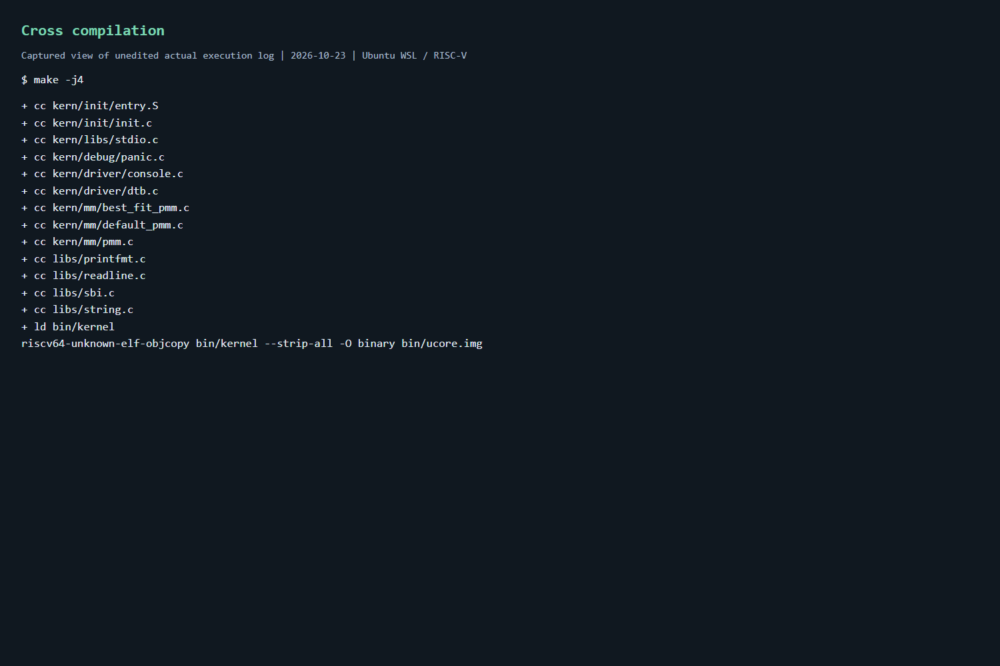
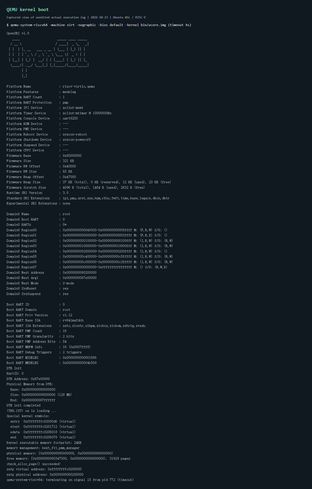
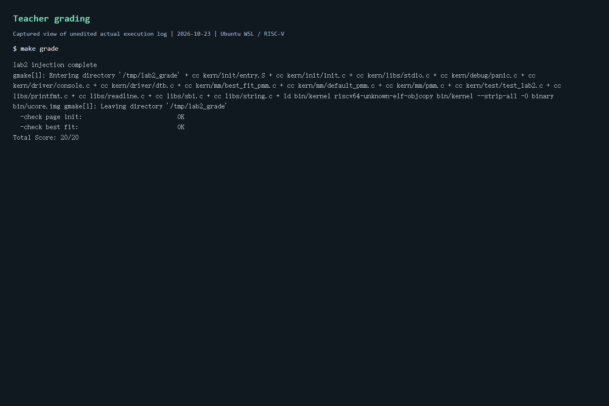

# 操作系统实验报告

## 实验基本信息

| 项目 | 内容 |
|------|------|
| **实验名称** | Lab 2：物理内存初始化与 Best-Fit 连续页分配 |
| **小组成员** | 2312418-李金璇（当前可核实成员；原 Lab1 报告未列出其他成员） |
| **完成日期** | 2026-10-23 |
| **实验分支** | lab2 |
| **小组仓库** | https://github.com/Tempo67-ai/OS |

### 小组分工

| 成员 | 负责的练习/模块 |
|------|----------------|
| 2312418-李金璇 | 全部实验代码、编译运行验证、实验报告整理和提交 |

实验报告各部分均由李金璇负责，使用 Codex 辅助完成代码实现、故障定位及文档整理。AI 的实际使用提示词见 [prompt.md](prompt.md)。

## 一、实验目的

1. 理解 RISC-V 内核启动后的物理内存发现、虚实地址转换与页面描述符建立过程。
2. 实现 Best-Fit 连续页分配，掌握空闲块的查找、分裂、释放和合并。
3. 理解空闲链表、块首页标记和空闲页总数之间的一致性要求。
4. 通过交叉编译、QEMU 运行及框架断言检查验证实现，并记录 AI 辅助排错过程。

## 二、实验环境

| 项目 | 环境 |
|------|------|
| 宿主环境 | Windows，Ubuntu WSL |
| 目标架构 | 64 位 RISC-V，QEMU virt，Sv39 |
| 编译器 | riscv64-unknown-elf-gcc |
| 模拟器 | qemu-system-riscv64 |
| 固件 | QEMU 默认 OpenSBI |
| 默认模拟内存 | 128 MiB，物理区间 [0x80000000, 0x88000000) |
| 构建与验证 | GNU Make、Python 3 测试注入脚本、Shell 评分脚本 |

| 成员 | AI 编程工具 | 底层模型 | 备注 |
|------|------------|---------|------|
| 2312418-李金璇 | Codex 桌面应用 | GPT-6 系列 Codex agent；具体版本未由会话界面核实 | 辅助实现、编译、排错及报告整理 |

## 三、实验整体逻辑分析

### 3.1 本章节的逻辑主线

本实验解决“哪些物理页可以使用，以及如何连续分配和回收这些页”的问题。内核不能直接把全部 DRAM 当作空闲内存，因为 OpenSBI、内核镜像、启动栈、启动页表和页面描述符本身均占用物理页。

实验先从设备树取得物理内存范围，为每个物理页建立描述符；再排除已占用区域，把剩余页面组成空闲块链表；最后通过统一的 pmm_manager 接口实现连续页面的分配与释放。

### 3.2 功能的逐步实现

1. 保证启动代码能够进入高虚拟地址内核，设备树提供 DRAM 基址与大小。
2. 初始化 Best-Fit 管理器的链表和计数，以便接收可用物理页。
3. page_init 建立描述符并保留已用页面，将可用页面交给 init_memmap。
4. 实现 Best-Fit 的选块、分裂和合并，供 alloc_pages/free_pages 调用。
5. 先执行框架内置分配器检查，再由 make grade 注入额外检查并评分。

## 四、实验内容与实现

源码中实际存在两处 YOUR CODE 标记，分别对应物理页初始化和 Best-Fit 实现。目录中未提供单独的 exercises 文档，因此按这两处标记组织本节，没有额外虚构 Challenge 任务。

### 功能模块一：物理页初始化

**负责人：** 2312418-李金璇

#### 模块功能描述

需要实现或修改的函数：

~~~c
static void page_init(void);
static void init_pmm_manager(void);
~~~

文件为 [pmm.c](../code/kern/mm/pmm.c)。init_pmm_manager 选择 best_fit_pmm_manager 并初始化；page_init 建立页面描述符和可用内存范围。

关键处理如下：

1. 调用 get_memory_base/get_memory_size 获取内存信息，设置 va_pa_offset 为 PHYSICAL_MEMORY_OFFSET。
2. 计算 npage = PPN(mem_base + mem_size)。npage 表示物理内存末端页号，描述符数量为 npage - nbase，不能直接把 npage 当作实际内存页数。
3. 将 pages 放在 ROUNDUP(end, PGSIZE)，确保描述符数组从内核末尾之后的页边界开始。
4. 计算描述符数组末尾的物理地址并向上对齐，得到 free_start；内存末端向下对齐得到 free_end。
5. 将所有描述符初始化为保留状态，并初始化引用计数、property 和链表节点。
6. 仅对 [free_start, free_end) 调用 init_memmap，避免 OpenSBI、内核及描述符数组被错误分配。

实现沿用框架的单段 DRAM 模型，要求 DRAM 从 0x80000000 开始且不超出启动页表映射的 1 GiB 范围；不声称支持任意设备树中的多段内存或全部保留区表。

#### 最终提示词

本次会话没有逐模块改写提示词。两个模块均由同一条实际任务提示驱动：

> 这是我操作系统课程的实验，请你帮我完成。文件夹里有老师布置的代码，具体任务在lab2文件夹中都有体现

AI 根据源码标记和现有测试细化实现步骤；未将内部推理或自主排错描述成用户实际发送过的提示词。

#### 实现迭代过程

**第一次迭代：** 补齐 page_init 并切换管理器，交叉编译通过。全系统评分起初因缺少 RISC-V QEMU、内核入口未交给 OpenSBI、分页过渡缺少恒等映射而无法运行至检查点。

**问题解决策略：** 安装对应工具，按本报告第三模块修复启动路径。此过程由 AI 在同一条原始任务下自主排错，没有新增的用户模块提示词。

**最终结果：** 框架的 Page Init 检查通过，内核尾页及描述符数组所在页保持保留状态。

### 功能模块二：Best-Fit 连续页分配

**负责人：** 2312418-李金璇

#### 模块功能描述

文件为 [best_fit_pmm.c](../code/kern/mm/best_fit_pmm.c)，实现函数如下：

~~~c
static void best_fit_init(void);
static void best_fit_init_memmap(struct Page *base, size_t n);
static struct Page *best_fit_alloc_pages(size_t n);
static void best_fit_free_pages(struct Page *base, size_t n);
static size_t best_fit_nr_free_pages(void);
~~~

free_area 保存空闲链表与空闲页数。链表按页面地址递增排序，每个节点代表一个连续空闲块，只有块首页设置 PG_property，其 property 为整个块的页数。

**初始化：** init 清空链表和计数；init_memmap 清除可用页保留状态，设置块首页属性，并按地址插入链表。

**分配：** 若 n 大于总空闲页数，直接返回 NULL；否则扫描链表，从 property >= n 的块中选择 property 最小者。遇到大小恰好为 n 的块可立即停止。对于同样大小的块，由于仅在严格更小时替换候选，优先使用地址较低者。

找到块后将其摘除；如果块大于请求，从块前部取出 n 页，把剩余部分以新的块首页插回原位置。最后减少 nr_free 并清除已分配块首页的 PG_property。总空闲页数足够但没有足够大的连续块时，同样返回 NULL。

**释放：** 检查待释放页面没有保留或空闲块首页标记，重置页面状态及引用计数，按地址插入新空闲块。随后依次检查前驱和后继，物理连续时累加 property，清除被合并节点标记并摘除节点。仅释放操作增加 nr_free，合并不额外改变计数。

**示例：** 同时存在 2 页空闲块和 1 页空闲块，请求 1 页时选择后者，保留完整的 2 页块。老师的 best_fit_check 包含类似场景。

**复杂度：** k 为空闲块数，分配最坏 O(k)，释放定位 O(k)，邻块合并 O(1)。Best-Fit 仍可能产生较小碎片，不能消除外部碎片。

#### 最终提示词

与模块一使用同一条原始实验请求，完整原文及后续交付提示见 [prompt.md](prompt.md)。

#### 实现迭代过程

**第一次迭代：** 参照已提供的 First-Fit 管理器完成链表、分裂和回收逻辑，将“找到第一个足够大的块”改为“查找最小足够大的块”。

**第二次迭代：** 复查插入链表末尾的分支，插入完成后立即 break，避免继续遍历刚插入节点。此项属于源码复查改进，不是测试曾失败的断言。

**最终结果：** 原有 basic_check 和 best_fit_check 断言通过，评分确认选用 best_fit_pmm_manager。测试函数和评分判定均未改写。

### 功能模块三：启动兼容性修复

**负责人：** 2312418-李金璇

#### 模块功能描述

修改 [entry.S](../code/kern/init/entry.S)、[Makefile](../code/Makefile) 和 [grade.sh](../code/tools/grade.sh)。

#### 最终提示词

同原始实验请求。启动故障在执行验证时发现，未额外编造用户提示词。

#### 实现迭代过程

**第一次迭代：** 初次执行 make grade 提示 qemu-system-riscv64 不存在。当前 Ubuntu 将该架构模拟器拆分为 qemu-system-riscv 包，安装后继续验证。

**第二次迭代：** 原 -device loader 加载方式下，OpenSBI 日志显示 Domain0 Next Address 为 0，未进入内核。改用 -kernel bin/ucore.img，使入口正确设置为 0x80200000；普通运行、调试和评分启动方式同步调整。

**第三次迭代：** 入口正确后仍没有内核输出。启动页表原来仅包含高虚拟地址映射，写入 satp 后下一条指令仍在低物理地址执行。补充根页表索引 2 的 1 GiB 恒等映射，覆盖 [0x80000000, 0xc0000000)，同时保留索引 511 的高地址映射，保证过渡期间能够取指。

最终内核完成设备树解析、物理页初始化和分配检查。该恒等映射仅为本教学内核启动所用；实验不实现运行后移除低地址映射或细粒度权限管理。

## 五、测试与验证

### 5.1 运行方法

在 Ubuntu WSL 中进入仓库的 code 目录后执行：

~~~bash
make -j4
make qemu
# 退出 QEMU：Ctrl+A，然后 X
make grade
~~~

内核最后进入 while (1)，没有命令提示符，属于框架预期行为。make grade 在 /tmp/lab2_grade 副本中注入检查，不污染提交源码，但会清理 code 下构建产物，必要时重新 make。

### 5.2 编译、启动与评分结果

以下图片为**原始真实执行日志在浏览器中的视图截图**，不是桌面终端窗口截图，也没有改写日志结果。对应的原始文本同时保存在 logs 目录，便于复核。

**编译：** 提交目录执行 make -j4，生成 bin/kernel 和 bin/ucore.img，框架启用 -Wall 与 -Werror。

[完整编译日志](logs/build.txt)

**启动：** 采用 make qemu 对应的相同 QEMU 参数执行，外加 4 秒 timeout 以结束内核无限循环；日志末尾的 signal 15 是该超时结束产生。

[完整启动日志](logs/boot.txt)

本次默认 128 MiB 内存下的关键输出：

~~~text
memory management: best_fit_pmm_manager
physical memory: [0x0000000080000000, 0x0000000088000000)
free memory: [0x0000000080347000, 0x0000000088000000), 31929 pages
check_alloc_page() succeeded!
satp virtual address: 0xffffffffc0205000
satp physical address: 0x0000000080205000
~~~

上述地址是当前构建结果，内核大小变化时，描述符及空闲区起点可以改变。

**评分：** 在最终提交目录运行老师原有 make grade，结果如下。

[完整评分日志](logs/grade.txt)

~~~text
check page init: OK
check best fit:  OK
Total Score: 20/20
~~~

### 5.3 验证覆盖范围与限制

- basic_check 验证独立页面分配、引用计数、耗尽和回收。
- best_fit_check 验证最小适配选择、失败返回、回收及空闲页总数恢复。
- test_page_init 检查偏移、内存末端页号、描述符对齐、保留页及地址往返转换。
- test_best_fit 额外确认当前管理器为 best_fit_pmm_manager；算法行为主要由此前内置断言验证。
- 本次结论限于现有框架检查与默认 128 MiB QEMU 场景，不将 20/20 等同于所有内存配置、并发场景或非法释放情况都已验证。

## 六、实验总结与收获

### 对操作系统的理解

| 实验知识点 | 对应 OS 原理 | 联系与差异 |
|------------|-------------|------------|
| Page 描述符和保留标记 | 物理内存资源管理 | 管理结构本身也占用内存，必须先保留再释放可用区 |
| Best-Fit、分裂和合并 | 连续内存分配及外部碎片 | 本实验以页为单位，并非按任意字节分配的通用堆 |
| 地址有序空闲链表 | 空闲空间组织 | 地址排序便利邻块合并；最优适配仍需扫描块大小 |
| 虚实地址固定偏移与 satp | 分页地址转换、TLB | 本实验复用静态大页映射，未实现完整进程页表 |
| 开启分页时的恒等映射 | 地址空间切换的连续性 | 控制寄存器切换后，当前 PC 和访存仍需有有效映射 |

原理课程中重要但本次没有实现的内容包括：缺页异常处理、按需分页、页面置换、交换空间、写时复制、用户进程隔离、并发分配锁及 NUMA 内存管理。不能将本实验的物理分配器等同于完整虚拟内存系统。

### AI 协作开发的经验

1. 提示词较概括时，必须先让 AI 读取源码标记、接口及测试，再确定任务范围，避免凭其他版本的课程内容补题。
2. 编译通过不能证明内核已正常启动。此次从 OpenSBI 入口日志和分页过渡映射两方面定位问题，说明应区分工具缺失、启动故障与算法错误。
3. 保留老师测试并在最终提交目录重新执行，能避免报告引用旧目录或旧构建的结果。
4. AI 自主排错不等于用户多次修改提示词，prompt.md 应记录真实交互；报告也应说明截图来源及验证边界。
5. Best-Fit 的核心变化是选块策略，链表顺序与合并规则仍应保持一致，复用框架前需核查其循环边界。

## 参考材料

- 本次老师提供的 Lab2 源码、tools/test_lab2.c、tools/grade.sh。
- 老师提供的《实验报告模板.md》。
- 本仓库 main 分支已有 Lab1 报告，用于理解前次启动环境。
